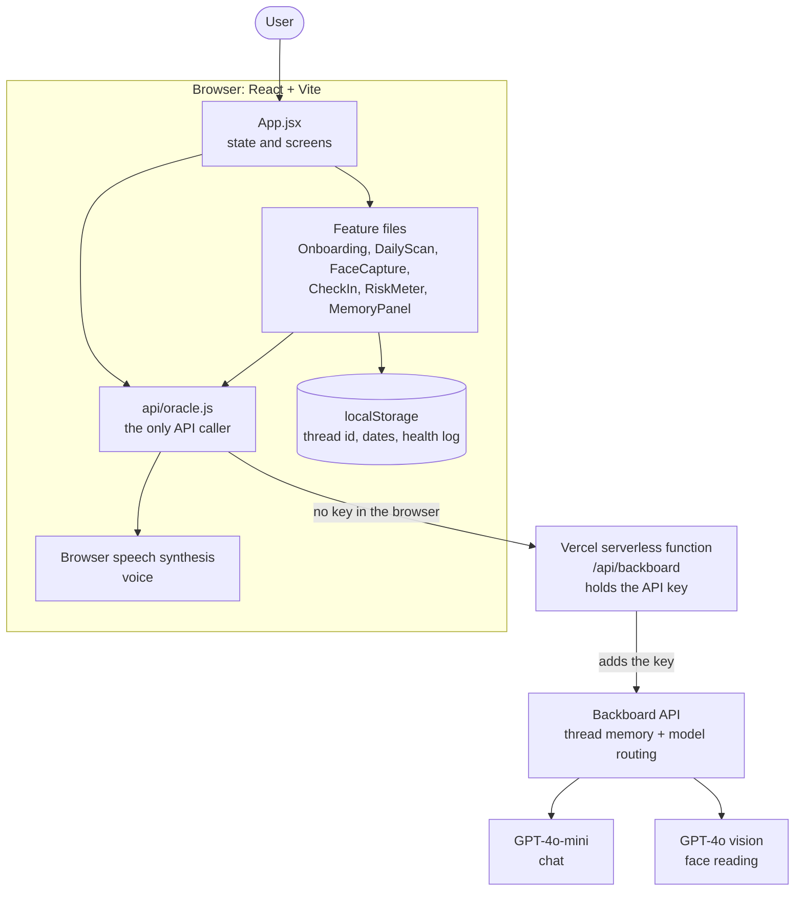
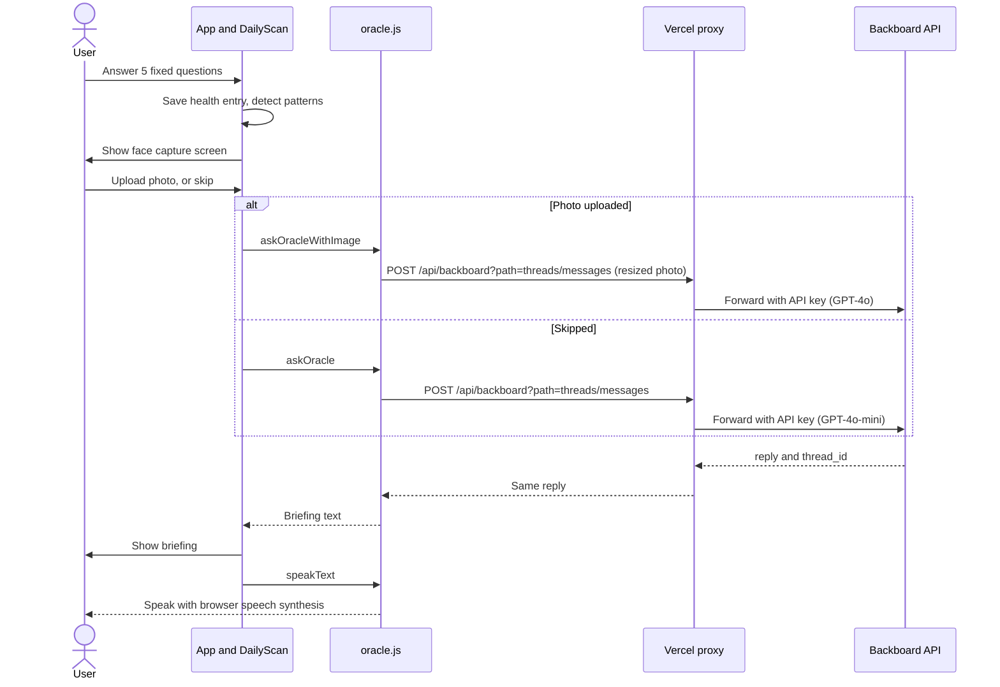
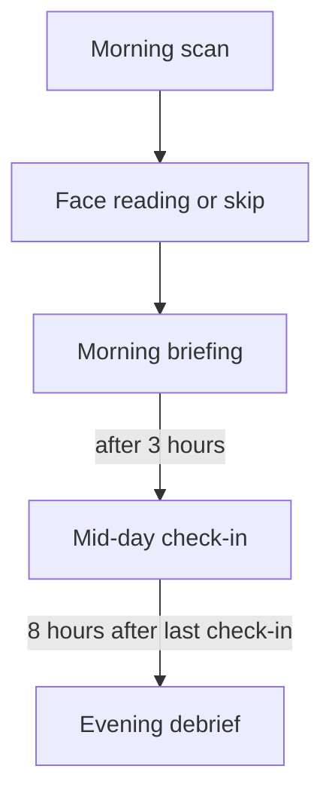

# ORACLE

### The AI agent that lives your day before you live it. Your mental crack into tomorrow.

> Won **Most Creative** at the Backboard.io Spring 2026 Hackathon

**[Try ORACLE live](https://oracle-six-snowy.vercel.app)**

---

## What is ORACLE?

Most wellness apps react to how you are feeling. ORACLE does not react. It intercepts.

ORACLE is a personal AI guardian that runs a daily three-part mental performance loop. It sees the risk in your day before you do, cross-references what you say against what your face reveals, and tracks you from morning through evening to close the loop.

## How It Works

**Morning Scan**
Five sharp questions covering your schedule, sleep quality, main uncertainty for the day, energy reading, and physical state. Not generic wellness questions. Five data points that together surface the hidden risk in your day. After the questions, ORACLE reads your face against your answers.

**Face Reading**
ORACLE captures a photo and cross-references it against everything you just said. If your answers say energy is high but your face shows dark circles and tension, ORACLE names that gap directly. The gap between self-reported state and physical reality is where days break down. ORACLE closes it.

**Mid-Day Check-In**
Three hours after your morning scan, ORACLE checks in with one sharp question about how the day is going relative to the morning prediction. Not therapy. A status check.

**Evening Debrief**
At the end of the day, ORACLE closes the loop. It references the prediction it made in the morning and asks whether it came true. Your last 7 days of energy, sleep, and physical state feed into each morning's briefing, so recurring patterns like several low-energy days in a row get named early.

## Built On

ORACLE is built on the Backboard API.

**Thread Memory** — The morning briefing, mid-day check-in, and evening debrief share the same thread ID while the app stays open, so ORACLE keeps the context of your day across the three sessions. No custom memory system needed.

**Model Routing** — Conversation, the mid-day check-in, and the evening debrief use GPT-4o-mini. The face reading routes to GPT-4o with vision capability. Backboard handles the routing with one API key.

**Voice** — ORACLE speaks its replies aloud. It first tries Backboard's TTS endpoint (OpenAI's onyx voice). That call currently returns a 404, so the voice you hear comes from the browser's built-in speech synthesis fallback.

## Tech Stack

- React, Vite
- Backboard API: thread memory, model routing, multimodal vision
- GPT-4o vision for face reading
- Vercel serverless function that keeps the API key on the server
- Browser speech synthesis for voice
- Deployed on Vercel

## Architecture

ORACLE is a single-page React app with one small serverless function and no database. The browser never talks to Backboard directly. Every AI call goes through `src/api/oracle.js` to a Vercel serverless function at `/api/backboard`, which adds the secret API key and forwards the request to Backboard. State that needs to survive a refresh lives in the browser's `localStorage`.

**How the pieces fit**

- **`App.jsx`** owns the shared state (messages, thread ID, scan status, check-in timers) and decides which screen to show: onboarding, face capture, or the main chat.
- **`src/features/`** holds one file per feature, so each can change without touching the others.
- **`oracle.js`** is the only place in the browser that makes API calls. It sends every request to `/api/backboard?path=<endpoint>`. `speakText` tries Backboard's TTS first and falls back to the browser's speech synthesis, which is what currently happens.
- **`api/backboard.js`** is the serverless proxy. The Backboard key lives only in a Vercel environment variable (`BACKBOARD_API_KEY`), so it is never sent to the browser or included in the JavaScript bundle. The function accepts POST requests only, forwards only the two endpoints the app uses (`threads/messages` and `tts`), only allows the two models the app uses (`gpt-4o-mini` and `gpt-4o`), and rejects requests whose origin is another website.
- **`HealthTracker.js`** keeps the last 7 days of energy, sleep, and physical state in `localStorage` and flags streaks such as low energy several days in a row.
- **Model routing:** the cheaper GPT-4o-mini handles text. GPT-4o with vision is used only for the face reading, which keeps cost and latency down.
- **Photo size:** the face photo is resized in the browser before upload, which keeps the request under the serverless function's size limit and makes the vision call faster.

### Morning scan flow

### Daily loop and timers

The timers run in the browser (`useCheckinTimer` checks every 60 seconds).

## Design decisions and trade-offs

I prioritized shipping a complete daily loop within the hackathon timeframe, a clean modular structure, and keeping the health log private on the user's device. After the hackathon I added the serverless proxy so the API key is no longer exposed in the browser.

| Decision | Why | What it costs |
|---|---|---|
| A thin serverless proxy and no database | The key stays on the server, with almost nothing to host or maintain | Anyone can still call the proxy through the site, so per-user rate limiting is not in place yet |
| Backboard thread memory instead of a custom memory system | One thread ID gives the model context across the day, no database | Memory depends on a thread ID kept in the browser |
| Health history in `localStorage` | Private, no login, no database | Lost if browser data is cleared, not shared across devices |
| Timers in the browser | Simple, works with browser notifications | Notifications only fire while the app is open |
| GPT-4o-mini for text, GPT-4o only for the photo | Lower cost and latency | Two code paths to maintain |
| Resize the photo in the browser | Stays under the serverless request limit, faster upload | Less image detail reaches the model |
| System prompts stay in the browser | Simple, each feature file picks its own prompt | The proxy accepts whatever prompt it is sent |

## Known limitations

- **No rate limiting on the proxy yet.** The key is safe on the server, and the proxy limits endpoints, models, and origins, but it has no per-user limits. Because the browser sends the system prompt, it can also be used as a general chat relay.
- **The origin check only stops other websites.** It only applies when a request carries an `Origin` header, so a script that leaves it out can still reach the proxy.
- **Backboard TTS returns a 404.** The voice falls back to the browser's built-in speech synthesis.
- **Check-ins depend on an open tab.** Notifications only fire while the app is open. On reopening, the banner appears if enough time has passed since the last saved check-in, and after 8 hours both banners show together. The notification repeats every minute until answered, and the evening debrief is timed from the last check-in rather than from the morning scan.
- **Thread memory is partial.** The thread ID is removed from `localStorage` when the scan finishes, so after a refresh the next request starts a new thread unless a chat message has saved the ID again.
- **Chat messages (yours and ORACLE's) are rendered as HTML** with `dangerouslySetInnerHTML` and are not sanitized.
- **The face photo is sent to Backboard and its model provider** as base64. The app does not store it, and there is no privacy notice before capture yet.
- **Unused dependency:** `backboard-sdk` is in `package.json`, but the app calls the API with `fetch`.

## Next steps

1. Add per-user rate limiting to the proxy, and move the system prompts to the server so the endpoint is not a general-purpose relay.
2. Fix the Backboard TTS call (the endpoint returns a 404).
3. Schedule check-ins on the server and send push notifications, with a separate saved flag for each check-in so timing is measured from the morning scan.
4. Store the thread ID per day and reuse it on reload.
5. Escape or sanitize model output before rendering it.
6. Add a privacy notice before face capture.
7. Remove `backboard-sdk` or use it in place of the raw `fetch` calls.

### At 10x the users

The browser-side app scales for free, so the limits are the shared pieces: Backboard and model rate limits, per-request cost (the vision call is the most expensive), and the serverless function. The proxy is also where per-user rate limits, caching, and cost monitoring would live, and scheduled check-ins would move to a queue or cron job.

## Run It Locally

1. Create a `.env` file in the project root with `BACKBOARD_API_KEY=your_key` (no `VITE_` prefix, so it is never bundled into the browser code).
2. Run `npm install` and `npm run dev`. The Vite dev server proxies `/api/backboard` to Backboard and adds the key, the same way the serverless function does in production.

## Try It

[oracle-six-snowy.vercel.app](https://oracle-six-snowy.vercel.app)

Open the app each morning. Answer the five questions. Let ORACLE see you.

## Who It Is For

Founders, developers, creatives, students. Anyone whose mental performance directly affects their output and wants something that tells them the truth, not just what they want to hear.

---

Built in Nigeria. Won Most Creative.